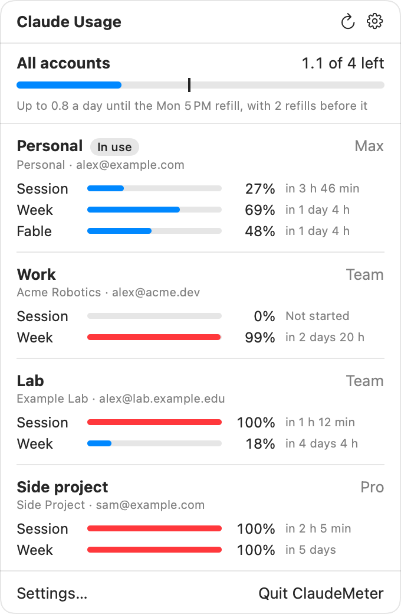
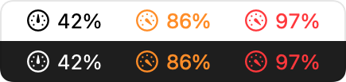

# ClaudeMeter

<picture>
  <source media="(prefers-color-scheme: dark)" srcset="docs/popover-dark.png">
  
</picture>



A macOS menu bar app that shows Claude subscription usage (session and weekly limits) for
several Claude Code accounts. The same email in two organizations counts as two accounts.

The menu bar shows a gauge and the tightest limit of the account in use, for example `69%`.
It turns orange at 80 % and red at 95 %, and shows `–` when there is no data, the last probe
failed, or the numbers are more than 30 minutes old. The popover lists every account with its
session, week and per-model limits, reset times, and extra usage when it is enabled.

## Install

Requires macOS 14 or later on Apple silicon.

1. Download `ClaudeMeter-<version>.zip` from
   [Releases](https://github.com/qiayuanl/claude-meter/releases) and unzip it.
2. Move `ClaudeMeter.app` to `/Applications`.
3. Open it. The app is signed ad hoc and not notarized, so macOS blocks the first open.
   Allow it in **System Settings > Privacy & Security > Open Anyway**, or run
   `xattr -dr com.apple.quarantine /Applications/ClaudeMeter.app`.

## Build from source

Requires Swift 6 (the Command Line Tools are enough).

```sh
make build     # debug build
make test      # unit tests (Swift Testing); plain `swift test` runs none with only the CLT
make app       # build/ClaudeMeter.app, signed ad hoc
make install   # copies the app to /Applications and registers it
```

`ClaudeMeter --probe-once <folder>` probes one account folder, prints the parsed result as
JSON and exits with status 1 when the probe failed. Each run is a real `/usage` request.
`make previews` writes the images above from fictional accounts
(`ClaudeMeter --render-previews docs`).

## Accounts

Each account is a Claude Code config folder in `~/.claude-accounts/<slug>`. **Add Account…**
asks for a name, creates the folder (mode 0700) and opens Terminal with `claude auth login`
for it. To track a second organization with the same email, add another account and pick that
organization while signing in. Settings renames (double-click), reorders (drag), signs in
again and removes accounts. Removing only forgets the account; the folder stays. Settings
warns when two accounts are signed in as the same email and organization.

## Which account is in use

Every 5 s ClaudeMeter reads `<folder>/sessions/<pid>.json` in each account folder and in
`~/.claude`, where plain `claude` runs. A session counts while its process is alive, and the
session updated last decides; ClaudeMeter's own `claude` runs do not count. Sessions in an
account folder belong to that account. Without a live session the last account in use stays.

`~/.claude` follows `claude auth login` switches. Each refresh, and after every sign-in there,
ClaudeMeter runs `/usage` for `~/.claude` and picks the account whose limits reset at the same
times. The profile in `~/.claude.json` is only a fallback, because it can keep an old
organization after a switch. That account's own folder is not probed in the same round.

## All accounts

The block above the accounts treats all accounts as one pool. It appears once every signed-in
account has numbers. The unit is one account's weekly limit, so the pool assumes every account
has the same limit (for example, Team seats of one tier).

- **Bar.** The weekly room left in all accounts, for example `3.6 of 8 left`.
- **Tick.** The room that even use of each account would leave: each account used at an even
  rate that reaches 100 % at its weekly reset. An account that resets in 70 hours would have
  70/168 of its week left.
- **Daily budget.** `Up to 1.3 a day until the Wed 5 PM refill`: the most you can use per day,
  on average, without running out before any weekly reset in the next 7 days. For each reset,
  the room usable before it counts the room now, the refills of earlier resets, and at most one
  full session (about 17 %) per account per 5 hours; divided by the days until that reset, it
  gives a budget. The line shows the smallest budget and its reset, so a reset that refills little does
  not hide a long wait for the next one. When earlier resets count, the line says how many:
  `…, with 2 refills before it`.
- **Verdict.** A forecast at your pace: `Runs out Wed 2 PM at your pace` (red),
  `~0.8 expires unused by Nov 8, 2 PM` (orange) or `Lasts the week at your pace` (green).
- **Next.** The usable account with the most room per active hour left before its reset. The
  account in use stays while its numbers leave room, until its session caps, unless the other
  account's number is 1.5 times larger.

Your pace is the pool's use over the last 7 days. Each probe books an account's weekly increase
into hourly totals in `history.json`; after 7 days the pace also follows the hour-of-week
pattern of the last 4 weeks. Before 7 days of history, and for 7 days after use went unbooked
(a reset passed while the app was not probing, or an account was added in the middle of its
week), only a lower bound is known: all weekly use in the open windows over the age of the
oldest window. The verdict then shows only a run-out that the lower bound already reaches
(`Runs out by …`).

The forecast simulates the next 7 days in 10-minute steps. Each step's use goes to the account
with the most room per active hour left before its weekly reset; active hours weigh clock hours
by the hour-of-week pattern, so nights and weekends without use count less. Each account gives
at most its weekly room and its 5-hour session room. One session holds about 17 % of a week;
the app learns the exact size from its probes. A reset refills the account, and a reset that
has passed counts as a full account whose next reset is 7 days later. The pool runs out when
more than 0.05 account of use cannot be served. The menu bar adds `!` when no account has room
now or the pool runs out within 24 hours.

## Data source and rate limits

ClaudeMeter runs the official CLI and never reads credentials or calls Anthropic itself:

```sh
claude -p /usage --output-format stream-json --verbose --no-session-persistence --strict-mcp-config
claude auth status
```

Anthropic allows about 30 usage requests per hour per account, so ClaudeMeter probes one
account at a time, every account and `~/.claude` every 5 minutes, and on Refresh at most once
per minute. After a "rate limited" answer it skips that account for 15 minutes. "Updated" in
the tooltip is the time Claude Code fetched the numbers (`cachedUsageUtilization.fetchedAtMs`).
A limit whose reset time has passed counts as 0 %.

State lives in `~/Library/Application Support/ClaudeMeter/state.json` and the usage history
in `history.json` next to it (no secrets). A file that cannot be decoded is renamed to
`<name>.bad` and the app starts fresh.

## Releasing

`git tag v0.1.0 && git push origin v0.1.0` builds the app and publishes a GitHub release.

## License

GPL-3.0. See [LICENSE](LICENSE).
